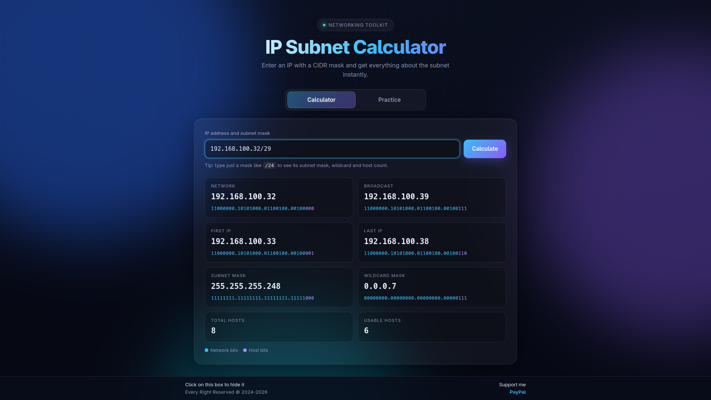

<div align="center">

# 🌐 IP Subnet Calculator & Practice

**A fast, modern subnet calculator and practice tool, right in your browser.**

[](https://wattox00.github.io/ip)
[](LICENSE)




</div>

---

## ✨ Features

- **Instant subnet calculator**: results update as you type, for any mask from `/0` to `/32`
- **Colour-coded binary**: network bits and host bits are highlighted so you can see the split at a glance
- **Mask-only mode**: enter just `/24` to get the subnet mask, wildcard mask and host counts
- **Practice mode**: random IPs to work out by hand, with Class A / B / C / Under filters
- **Instant feedback**: correct answers turn green, wrong ones red, with a score
- **Responsive**: built mobile-first, works well on phones, tablets and desktops
- **Zero dependencies**: plain HTML, CSS and JavaScript, no build step

## 🚀 How to use

### Calculator
1. Open the **Calculator** tab.
2. Enter an address in CIDR notation, e.g. `192.168.100.1/24`.
3. The results appear right away (or press **Enter** / **Calculate**):
   - Network and broadcast address
   - First and last usable IP
   - Subnet mask and wildcard mask
   - Total and usable hosts

> 💡 Type only a mask such as `/24` (or `24`) to see its subnet mask, wildcard and host count.

### Practice
1. Open the **Practice** tab and click **Generate** to get a random IP with a mask.
2. Optionally pick a class chip (**Class A / B / C / under**) to limit which masks are generated. Click the chip again to turn the filter off.
3. Fill in the **Network**, **Broadcast**, **First IP** and **Last IP** fields (last octet in decimal and binary, plus the full IP).
4. Click **Check Result** to see which answers are right.

### Footer
Click the footer bar to hide it. Use the round button in the corner to bring it back.

## 🛠️ Run locally

No installation needed:

```bash
git clone https://github.com/wattox00/ip.git
cd ip
# open index.html in your browser, or serve it:
python3 -m http.server 8000
```

## 📁 Project structure

```
ip/
├── index.html    # markup
├── style.css     # styling and responsive layout
├── script.js     # subnet maths, calculator and practice logic
├── logo.png      # favicon
└── src/
    └── demo.png  # screenshot
```

## ❤️ Support

If this project saved you time, taught you something, or made your day a little easier,
you can support its development here:

👉 **[Buy me a coffee via PayPal](https://www.paypal.com/paypalme/wattox)**

Your support helps keep the project:
- Actively maintained
- Continuously improved
- Free and open source

Thanks for being part of the community 🤝

## 📄 License

This project is licensed under the **GNU General Public License v3.0**.
See the [LICENSE](LICENSE) file for full details.
